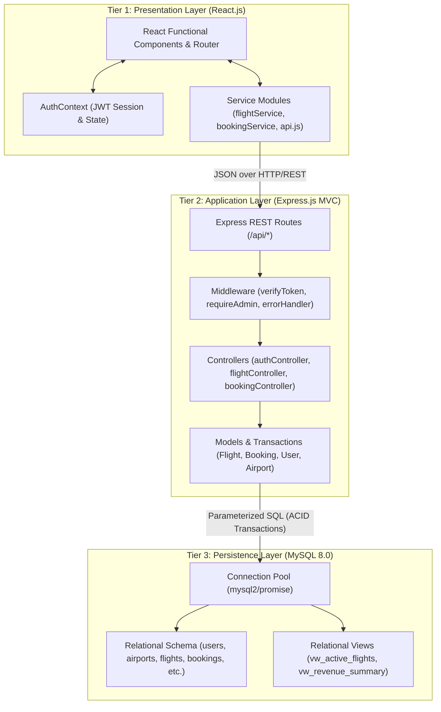
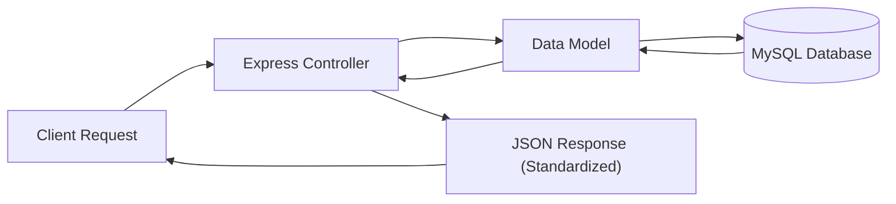
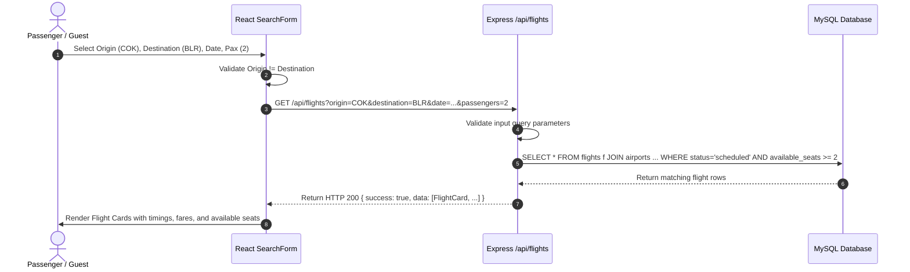
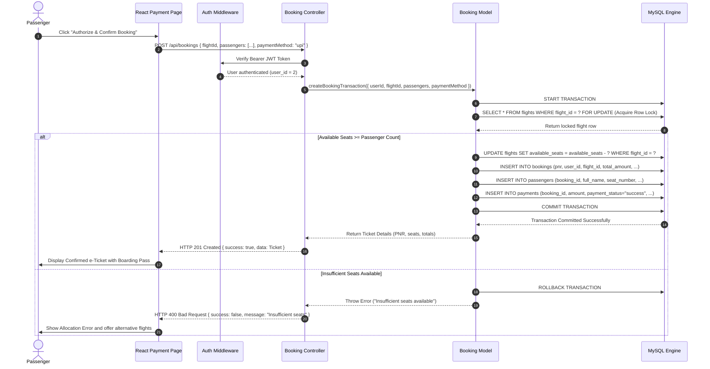
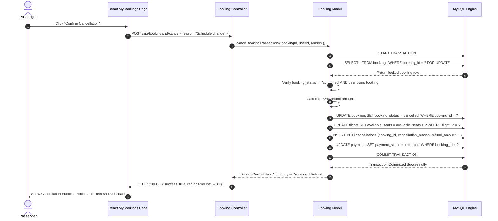

# System Architecture & Technical Design
## SkyBook — Flight Reservation System

---

## 1. High-Level 3-Tier System Architecture

SkyBook is organized into three distinct tiers ensuring separation of concerns:
1. **Presentation Tier (React Frontend)**: Manages client state, handles user events, executes form validation, and renders UI components.
2. **Application Tier (Node.js & Express MVC Backend)**: Enforces business logic, performs server authorization, authorizes JWT sessions, and coordinates ACID transactions.
3. **Data Tier (MySQL 8.0 Relational Database)**: Persists relational records, enforces referential integrity, supports row-level locking, and calculates aggregations via views.

---

## 2. Model-View-Controller (MVC) Pattern Implementation

The backend adopts the Model-View-Controller pattern tailored for REST APIs:
- **Model**: Encapsulates database queries, transaction management (`beginTransaction`, `commit`, `rollback`), row locking (`FOR UPDATE`), and data normalization.
- **Controller**: Orchestrates incoming HTTP requests, validates business rules, calls Model methods, and formats responses via standard helpers (`sendSuccess`, `sendError`).
- **View**: For a headless API, the view layer consists of formatted, standardized JSON payloads with status codes, error arrays, and timestamp metadata.

---

## 3. Sequence Diagrams

### 3.1 Sequence Diagram: Flight Search Flow

---

### 3.2 Sequence Diagram: ACID Seat Reservation & Simulated Payment Flow

---

## 4. Sequence Diagram: Booking Cancellation & Inventory Release

---

## 5. Data Dictionary

### Table: `users`
| Column Name | Data Type | Constraints | Description |
| :--- | :--- | :--- | :--- |
| `user_id` | INT | PRIMARY KEY, AUTO_INCREMENT | Unique identifier for user |
| `full_name` | VARCHAR(100) | NOT NULL | User's full legal name |
| `email` | VARCHAR(120) | NOT NULL, UNIQUE | User email address for authentication |
| `phone` | VARCHAR(25) | NOT NULL | Contact telephone number |
| `password_hash` | VARCHAR(255) | NOT NULL | Salted bcrypt hash of password |
| `role` | ENUM | NOT NULL, DEFAULT 'passenger' | Access level: `passenger` or `admin` |
| `created_at` | TIMESTAMP | DEFAULT CURRENT_TIMESTAMP | Account creation timestamp |

### Table: `airports`
| Column Name | Data Type | Constraints | Description |
| :--- | :--- | :--- | :--- |
| `airport_id` | INT | PRIMARY KEY, AUTO_INCREMENT | Unique identifier for airport |
| `airport_code` | VARCHAR(10) | NOT NULL, UNIQUE | Standard 3-letter IATA station code |
| `airport_name` | VARCHAR(150) | NOT NULL | Official airport facility name |
| `city` | VARCHAR(100) | NOT NULL | City served by the airport |
| `country` | VARCHAR(100) | NOT NULL, DEFAULT 'India' | Country location |
| `is_active` | BOOLEAN | NOT NULL, DEFAULT TRUE | Operational flag for search |

### Table: `flights`
| Column Name | Data Type | Constraints | Description |
| :--- | :--- | :--- | :--- |
| `flight_id` | INT | PRIMARY KEY, AUTO_INCREMENT | Unique identifier for scheduled flight |
| `flight_number` | VARCHAR(20) | NOT NULL | Airline flight designation (e.g., AI-502) |
| `airline_name` | VARCHAR(100) | NOT NULL | Operating airline carrier name |
| `origin_airport_id` | INT | NOT NULL, FK &rarr; `airports` | Origin airport foreign key |
| `destination_airport_id`| INT | NOT NULL, FK &rarr; `airports` | Destination airport foreign key |
| `departure_time` | DATETIME | NOT NULL | Scheduled local departure time |
| `arrival_time` | DATETIME | NOT NULL | Scheduled local arrival time |
| `base_fare` | DECIMAL(10,2)| NOT NULL, CHECK (> 0) | Base ticket fare per passenger |
| `total_seats` | INT | NOT NULL, CHECK (> 0) | Total aircraft cabin seat capacity |
| `available_seats` | INT | NOT NULL, CHECK (>= 0 AND <= total_seats) | Real-time unreserved seat count |
| `status` | ENUM | NOT NULL, DEFAULT 'scheduled' | `scheduled`, `delayed`, `departed`, `arrived`, `cancelled`, `inactive` |

### Table: `bookings`
| Column Name | Data Type | Constraints | Description |
| :--- | :--- | :--- | :--- |
| `booking_id` | INT | PRIMARY KEY, AUTO_INCREMENT | Unique identifier for booking |
| `pnr` | VARCHAR(10) | NOT NULL, UNIQUE | 6-character booking reference code |
| `user_id` | INT | NOT NULL, FK &rarr; `users` | Reserving passenger foreign key |
| `flight_id` | INT | NOT NULL, FK &rarr; `flights` | Reserved flight foreign key |
| `booking_date` | TIMESTAMP | DEFAULT CURRENT_TIMESTAMP | Date and time booking was generated |
| `passenger_count` | INT | NOT NULL, CHECK (> 0 AND <= 9) | Number of travellers on reservation |
| `total_amount` | DECIMAL(10,2)| NOT NULL, CHECK (>= 0) | Gross total amount paid (including taxes) |
| `booking_status` | ENUM | NOT NULL, DEFAULT 'pending' | Current status: `pending`, `confirmed`, `cancelled` |
| `trip_type` | ENUM | DEFAULT 'one-way' | `one-way` or `round-trip` |

### Table: `passengers`
| Column Name | Data Type | Constraints | Description |
| :--- | :--- | :--- | :--- |
| `passenger_id` | INT | PRIMARY KEY, AUTO_INCREMENT | Unique passenger seat record |
| `booking_id` | INT | NOT NULL, FK &rarr; `bookings` | Parent booking reference (CASCADE DELETE) |
| `full_name` | VARCHAR(100) | NOT NULL | Passenger traveller name |
| `date_of_birth` | DATE | NULL | Date of birth for age verification |
| `passenger_type` | ENUM | NOT NULL, DEFAULT 'adult' | Category: `adult` or `child` |
| `seat_number` | VARCHAR(10) | NULL | Allocated seat (e.g., 12A, 14F) |
| `gender` | ENUM | NULL | Gender designation |

### Table: `payments`
| Column Name | Data Type | Constraints | Description |
| :--- | :--- | :--- | :--- |
| `payment_id` | INT | PRIMARY KEY, AUTO_INCREMENT | Unique payment record ID |
| `booking_id` | INT | NOT NULL, FK &rarr; `bookings` | Associated booking foreign key |
| `amount` | DECIMAL(10,2)| NOT NULL, CHECK (>= 0) | Processed transaction amount |
| `payment_method` | ENUM | NOT NULL | Selected channel: `card`, `upi`, `netbanking` |
| `payment_status` | ENUM | NOT NULL | Transaction outcome: `success`, `failed`, `refunded` |
| `transaction_reference` | VARCHAR(100)| NOT NULL, UNIQUE | Audit transaction tracking string |
| `payment_date` | TIMESTAMP | DEFAULT CURRENT_TIMESTAMP | Payment settlement timestamp |

### Table: `cancellations`
| Column Name | Data Type | Constraints | Description |
| :--- | :--- | :--- | :--- |
| `cancellation_id` | INT | PRIMARY KEY, AUTO_INCREMENT | Unique cancellation record |
| `booking_id` | INT | NOT NULL, UNIQUE, FK &rarr; `bookings` | Cancelled booking ID (1-to-1) |
| `cancellation_date` | TIMESTAMP | DEFAULT CURRENT_TIMESTAMP | Cancellation timestamp |
| `cancellation_reason` | VARCHAR(255)| NOT NULL | Reason provided for audit |
| `refund_status` | ENUM | NOT NULL, DEFAULT 'processed'| Refund state: `pending`, `processed`, `ineligible` |
| `refund_amount` | DECIMAL(10,2)| NOT NULL, DEFAULT 0.00 | Calculated refund sum returned to customer |
