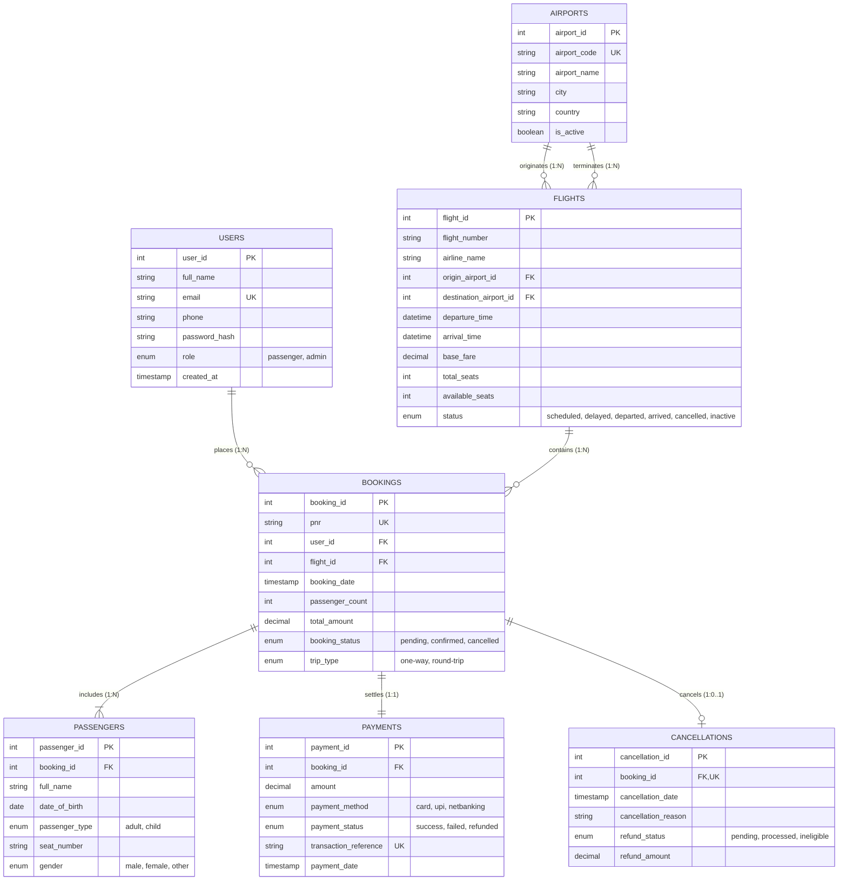

# Entity-Relationship (ER) Diagram
## SkyBook — Flight Reservation System

---

## 1. Complete Entity-Relationship Diagram

---

## 2. Cardinality & Relationship Breakdown

1. **`USERS` to `BOOKINGS` (1 : N)**
   - One user can make zero, one, or multiple flight bookings over time.
   - Each booking record is owned by exactly one registered user.
   - Foreign key: `bookings.user_id -> users.user_id`.

2. **`AIRPORTS` to `FLIGHTS` (1 : N for Origin, 1 : N for Destination)**
   - One airport serves as the origin hub for zero, one, or multiple flights.
   - One airport serves as the destination terminal for zero, one, or multiple flights.
   - Foreign keys: `flights.origin_airport_id -> airports.airport_id`, `flights.destination_airport_id -> airports.airport_id`.

3. **`FLIGHTS` to `BOOKINGS` (1 : N)**
   - A single scheduled flight can receive multiple customer bookings up to its total seat capacity.
   - Each booking is assigned to one primary flight itinerary.
   - Foreign key: `bookings.flight_id -> flights.flight_id`.

4. **`BOOKINGS` to `PASSENGERS` (1 : N)**
   - A single booking with headcount $N$ contains between 1 and 9 passenger traveller records.
   - Cascading delete: Removing a booking wipes its associated passenger records.
   - Foreign key: `passengers.booking_id -> bookings.booking_id`.

5. **`BOOKINGS` to `PAYMENTS` (1 : 1)**
   - Each confirmed booking maps to exactly one payment settlement record.
   - Foreign key: `payments.booking_id -> bookings.booking_id`.

6. **`BOOKINGS` to `CANCELLATIONS` (1 : 0..1)**
   - An active booking has zero cancellation records.
   - A cancelled booking has exactly one cancellation audit record.
   - Unique Foreign key: `cancellations.booking_id -> bookings.booking_id`.
