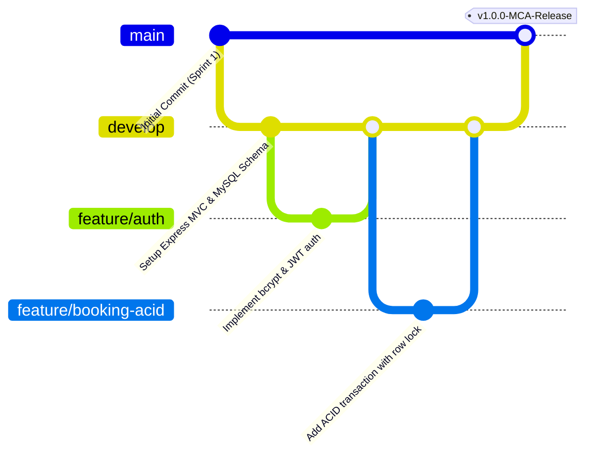

# Git Workflow & Collaborative Development Standards
## SkyBook — Flight Reservation System

---

## 1. Branching Strategy (Feature-Branch Workflow)

The project follows the standard Git Feature-Branch model ensuring that the `main` branch remains stable, deployable, and production-ready at all times.

- **`main`**: Production-ready, fully tested codebase with complete documentation.
- **`develop`**: Integration branch where completed sprint features merge prior to release.
- **`feature/<feature-name>`**: Isolated feature branches created for specific modules (e.g., `feature/flight-search`, `feature/acid-booking`).
- **`bugfix/<bug-name>`**: Hotfixes for critical defects found during testing.



---

## 2. Essential Git Commands Reference

### 2.1 Repository Setup & Branch Creation
```bash
# Initialize local repository
git init

# Configure developer identity
git config user.name "SkyBook Developer"
git config user.email "dev@skybook.local"

# Create and checkout develop branch
git checkout -b develop

# Create a feature branch
git checkout -b feature/flight-search
```

### 2.2 Staging, Committing, and Diff Review
```bash
# Check modified files and untracked files
git status

# Inspect specific line changes
git diff

# Stage specific files
git add server/models/Booking.js server/controllers/bookingController.js

# Stage all project files (respecting .gitignore)
git add .

# Create atomic commit with conventional prefix
git commit -m "feat(booking): implement ACID transaction with row lock and PNR generation"
```

### 2.3 Merging and Pushing
```bash
# Switch back to develop and update
git checkout develop

# Merge feature branch with no-fast-forward to preserve history
git merge --no-ff feature/flight-search -m "merge: integrate flight search module into develop"

# Delete feature branch after successful integration
git branch -d feature/flight-search

# Push to remote GitHub repository
git push -u origin develop
```

---

## 3. Commit Message Standards (Conventional Commits)

Commit messages must follow the format: `<type>(<scope>): <concise subject>`

| Type | Purpose | Example |
| :--- | :--- | :--- |
| `feat` | New user feature or module | `feat(auth): add role-based authorization middleware` |
| `fix` | Bug fix or error resolution | `fix(cancellation): prevent duplicate cancellation seat increments` |
| `docs` | Documentation update | `docs(srs): update non-functional requirements and data dictionary` |
| `test` | Automated test addition | `test(api): add 14 integration test cases for bookings` |
| `refactor` | Code restructuring | `refactor(db): extract connection pool into database.js` |
| `style` | CSS or UI token adjustment | `style(cards): refine flight card shadow and duration track` |

---

## 4. Secret Isolation & `.gitignore` Policy

Confidential secrets, credentials, node dependencies, and build artifacts must **never** be committed to version control.

### SkyBook `.gitignore` rules:
```gitignore
# Dependencies
node_modules/
.pnp
.pnp.js

# Environment Variables & Secrets
.env
.env.local
.env.development.local
.env.test.local
.env.production.local

# Build outputs
dist/
build/

# Logs
npm-debug.log*
yarn-debug.log*
yarn-error.log*
*.log

# OS & Editor Metadata
.DS_Store
Thumbs.db
.vscode/
.idea/
```
