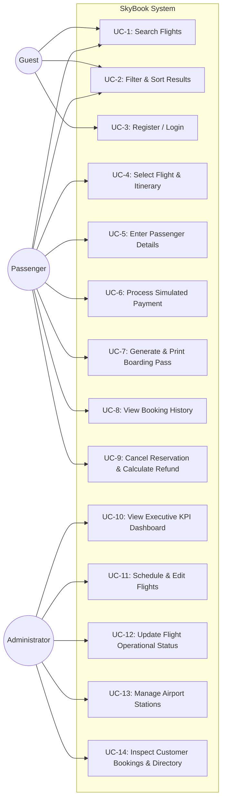

# Use Case Specifications & Actor Models
## SkyBook — Flight Reservation System

---

## 1. System Actors

| Actor | Category | Description |
| :--- | :--- | :--- |
| **Guest** | Primary Actor | External site visitor without authentication. Browses flights, checks fares, and inspects routes. |
| **Passenger** | Primary Actor | Authenticated registered user. Books seats, makes simulated payments, manages bookings, and cancels reservations. |
| **Administrator** | Primary Actor | High-privilege operational user. Manages flights, airport stations, inspects system-wide bookings, and monitors revenue. |
| **Simulated Payment Gateway** | Secondary Actor | System mock service that simulates payment authorization and transaction reference generation. |
| **MySQL Database System** | Secondary Actor | Relational persistence engine enforcing ACID transactions and referential integrity constraints. |

---

## 2. Use Case Diagram

---

## 3. Detailed Use Case Specifications

### Use Case UC-1: Search Flights
- **Primary Actor**: Guest or Passenger
- **Preconditions**: Airports exist in database with `is_active = TRUE`.
- **Main Success Scenario**:
  1. User specifies Origin Airport (e.g., COK), Destination Airport (e.g., BLR), Departure Date, and Passenger Count.
  2. System verifies Origin and Destination are distinct.
  3. System queries indexed `flights` table for `status = 'scheduled'` and `available_seats >= passenger_count`.
  4. System returns flight cards with departure/arrival times, duration, fares, and available seats.
- **Alternative Flow (Invalid Route)**:
  - At Step 2, if Origin and Destination match, client displays inline validation warning and stops submission.

---

### Use Case UC-6: Process Simulated Payment & ACID Seat Allocation
- **Primary Actor**: Passenger
- **Secondary Actors**: Simulated Payment Service, MySQL Database Engine
- **Preconditions**:
  - Passenger is authenticated with valid JWT token.
  - Selected flight has departure date in the future.
  - Passenger details array is validated.
- **Main Success Scenario**:
  1. Passenger reviews booking summary and selects payment method (Card / UPI / Net Banking).
  2. Passenger clicks "Authorize & Confirm Booking".
  3. Backend begins database transaction (`START TRANSACTION`).
  4. Backend locks flight row using `SELECT ... FOR UPDATE`.
  5. Backend verifies `available_seats >= passenger_count`.
  6. Backend updates flight inventory: `available_seats = available_seats - passenger_count`.
  7. Backend generates unique 6-character PNR (`SK` + random alphanumerics).
  8. Backend inserts booking record with status `confirmed`.
  9. Backend inserts individual passenger records with seat numbers.
  10. Backend inserts payment record with simulated transaction reference.
  11. Backend commits transaction (`COMMIT`).
  12. System returns 201 Created with complete ticket details and navigates to Confirmation page.
- **Exception Flow (Seat Exhaustion under Concurrency)**:
  - If at Step 5 another concurrent user claimed the last seats, system executes `ROLLBACK`.
  - System returns HTTP 400 Bad Request: "Insufficient seats available. Please retry."

---

### Use Case UC-9: Cancel Reservation & Restore Inventory
- **Primary Actor**: Passenger or Administrator
- **Preconditions**:
  - Booking is in `confirmed` status.
  - Flight departure timestamp is in the future.
- **Main Success Scenario**:
  1. User selects "Cancel" on an upcoming reservation in My Bookings.
  2. System shows cancellation modal displaying total fare, 15% cancellation fee, and 85% calculated refund.
  3. User confirms cancellation with selected reason.
  4. Backend begins database transaction with row lock on booking.
  5. Backend updates booking status to `cancelled`.
  6. Backend restores seats: `available_seats = available_seats + passenger_count`.
  7. Backend records cancellation audit row with timestamp and refund amount.
  8. Backend sets payment record status to `refunded`.
  9. Backend commits transaction.
  10. System displays cancellation confirmation with processed refund.
- **Exception Flow (Duplicate Cancellation Attempt)**:
  - If booking is already `cancelled`, backend rejects with HTTP 400: "Booking is already cancelled."
